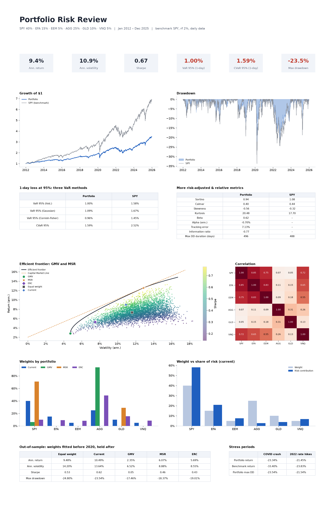

# Portfolio Risk Review

A compact, readable Python tool that reviews a multi-asset portfolio: risk metrics, tail-risk models, mean-variance
optimisation and model validation, summarised in a one-page report and an interactive Streamlit app.

Built by **Miller Hughes** while studying EDHEC's *Python for Investment Management*, with help from an AI coding assistant.
It deliberately sticks to `pandas`, `numpy`, `scipy` and `matplotlib` (plus Streamlit/Plotly for the app) so that every
line can be explained.

**Live app:** _coming soon_



## What it computes

| Area | Metrics |
|---|---|
| Performance | Annualised return & volatility, Sharpe, Sortino, Calmar |
| Drawdowns | Max drawdown, drawdown duration |
| Tail risk | VaR (historical, Gaussian, **Cornish-Fisher**), CVaR / Expected Shortfall, skewness, kurtosis |
| vs benchmark | Beta, alpha (CAPM), tracking error, information ratio |
| Structure | Correlation heatmap, **risk contribution** per asset |
| Optimisation | Efficient frontier, **GMV**, **MSR**, **ERC** (risk parity), Capital Market Line |
| Validation | **Out-of-sample** test of optimised portfolios, **rolling VaR backtest** with Kupiec test, crisis stress tests |

## Key findings (sample ETF portfolio, 2012-2025)
* The 40/15/5/25/10/5 portfolio (SPY/EFA/EEM/AGG/GLD/VNQ) had a max drawdown of -23.5% vs -33.7% for SPY, at the
  cost of a lower return (9.4% vs SPY's ~15% a year).
* Equity-like assets (SPY, EFA, EEM, VNQ) are 65% of the capital but ~93% of the risk. Weights alone hide where the
  risk really is.
* Daily returns are fat-tailed (kurtosis ~20 vs 3 for a normal distribution).
* **VaR backtest:** at 95% all three VaR methods pass the Kupiec test, and Gaussian is actually closest to the expected
  5% breach rate. At **99%**, Gaussian VaR is breached 2.2% of days instead of 1% and fails; historical VaR also
  fails; only **Cornish-Fisher** passes. The fat tails matter most in the far tail.
* **Out-of-sample:** GMV and MSR portfolios fitted on 2012-2019 data **underperformed** the simple current and
  equal-weight mixes from 2020 onward (Sharpe 0.05 and 0.46 vs 0.62). Optimisers fit noise in the historical returns,
  and this is what estimation error looks like in practice.

## Run it
```bash
pip install -r requirements.txt
python report.py           # writes report.png (and report.pdf)
streamlit run app.py       # interactive app: change weights, dates and risk-free rate
pytest                     # known-answer unit tests
jupyter notebook notebook.ipynb   # narrated step-by-step walkthrough
```
Change tickers, weights, dates and risk-free rate in [config.py](config.py). Prices come from Yahoo Finance via
`yfinance` and are cached in `prices_cache.csv`; delete that file to download fresh data.

## Project layout
```
config.py     settings (tickers, weights, dates, risk-free rate)
data.py       prices, returns, portfolio returns
metrics.py    all risk / performance functions, each with its formula in the docstring
optimize.py   GMV / MSR / ERC / efficient frontier (scipy SLSQP, long-only)
backtest.py   out-of-sample test, VaR backtest, stress tests
report.py     builds the one-page report
app.py        Streamlit app (uses the same modules, no extra maths)
tests/        pytest checks on toy examples
notebook.ipynb  explanation of each step
```

## Methods in one line each
* **VaR**: the loss exceeded on only 5% of days. **CVaR**: the average loss on those days.
* **Cornish-Fisher VaR**: Gaussian VaR with the z-score adjusted for skewness and excess kurtosis.
* **GMV**: minimise w'Σw. **MSR**: maximise (μ'w − rf) / √(w'Σw). **ERC**: give every asset an equal share of w'Σw.
* Constraints: weights ≥ 0 and sum to 1. Expected returns are historical averages, which is why the optimiser is fragile.

## Limitations / future work
Historical estimates are noisy; no transaction costs; daily rebalancing assumed. Next steps: Ledoit-Wolf covariance
shrinkage, Monte Carlo VaR, factor models, rolling re-optimisation.

---
*Educational project, not investment advice.* Licensed under the [MIT License](LICENSE).
